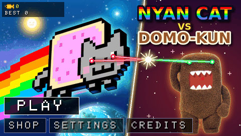
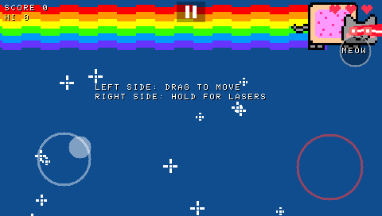
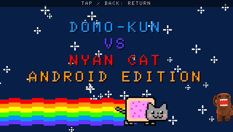

# Nyan Cat vs Domo-kun (Android)

Android port of the [PSP homebrew shoot-'em-up](https://github.com/McL0v1n-therealone/nyan-cat-vs-domo-kun). Fly Nyan Cat through space, dodge the
Domo-kun horde's spit balls and eye lasers, and blast them with your own laser eyes. 🌈🐱⚡

> ⚠️ Like the original, this port is 100% vibecoded.

| Title | Gameplay (touch controls) |
|---|---|
|  |  |



Runs on **Android 4.4 (API 19) and newer**. Tested on a Samsung Galaxy S3 (GT-I9300, 4.4.4).
The APK contains 32-bit and 64-bit ARM code, so it also runs on modern phones.

## Controls

| Touch | Action | PSP original |
|---|---|---|
| Drag on the **left half** (floating joystick) | Move | D-pad |
| Hold anywhere on the **right half** | Laser eyes | △ |
| **MEOW** button | Meow | ✕ |
| **II** button (top centre) / BACK / MENU key | Pause | START |
| Tap menu items | Select | ✕ |
| BACK | Back / resume / quit from title | ○ |
| Tap the score | Toggle performance meter | SELECT |

The hi-score is saved between sessions.

## How it's built

- `src/game.c`: the PSP game almost unchanged. It is the same software renderer drawing into a 480×272
  framebuffer, with the same rules and sound synthesis. The PSP debug font is in `src/font8x8.h`.
- `src/main.c`: the Android layer. It uses `NativeActivity` (no Java), shows the framebuffer through EGL + GLES2
  (scaled up with nearest-neighbour, letterboxed), plays audio through OpenSL ES, and handles multitouch and keys.
- `build.sh`: no Gradle. It runs clang (NDK) → aapt2 → zipalign → apksigner.

### Requirements

Android SDK with `build-tools;34.0.0`, `platforms;android-33` and `ndk;25.2.9519653`.
NDK r25c is the last NDK that can still target API 19.

```bash
sdkmanager "platforms;android-33" "build-tools;34.0.0" "ndk;25.2.9519653"
./build.sh            # -> build/NyanVsDomo.apk
./build.sh install    # build, adb install, launch
```

The APK is signed with `~/.android/debug.keystore`, which is created if it doesn't exist.
Set `KEYSTORE=...` to use another keystore. Test later difficulty levels with `CFLAGS=-DSTART_SCORE=15 ./build.sh`.

### Testing without a phone

`tools/host_render.c` runs the game core on the PC, simulates touches and dumps frames:

```bash
mkdir -p build/host
cc -O2 -fsanitize=address,undefined -Isrc tools/host_render.c src/game.c -lm -o build/host_render
./build/host_render build/host       # title/play/pause/dead/retry .ppm
tools/make_icon.py build/host/title.png   # regenerate launcher icons from the title screen
```

`src/domo_sprite.h` and `src/title_img.h` are copied from the [PSP project](https://github.com/McL0v1n-therealone/nyan-cat-vs-domo-kun). See its `tools/` to regenerate them.
