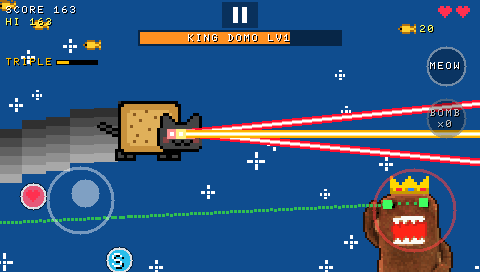
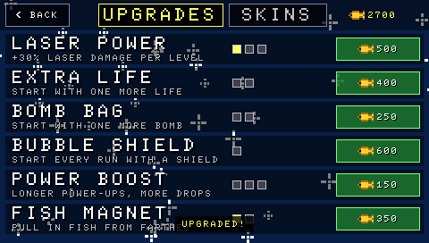
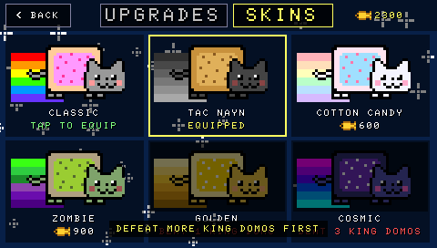

# Nyan Cat vs Domo-kun (Android)

A shoot-'em-up for Android that grew out of a [PSP homebrew game](https://github.com/McL0v1n-therealone/nyan-cat-vs-domo-kun).
Fly Nyan Cat through space, laser the Domo-kun horde, take down **King Domo**, collect fish and spend them
on upgrades and cat skins. 🌈🐱⚡

> ⚠️ Like the original, this game is 100% vibecoded.

| Title | Gameplay |
|---|---|
|  |  |
| **King Domo boss fight** | **Shop: upgrades** |
|  |  |
| **Shop: cat skins** | **Credits** |
|  |  |

Runs on **Android 4.4 (API 19) and newer**. Tested on a Samsung Galaxy S3 (GT-I9300, 4.4.4), where it runs at
60 FPS using about 2-3 ms of CPU per frame. The APK contains 32-bit and 64-bit ARM code.

## Features

- **King Domo boss fights**: a giant crowned Domo appears after 30 kills and then every 35. It has six attack patterns
  (spiral, fan volleys, sweeping eye lasers, minion summons, homing balls and a charge) and an enraged phase 2.
  Each King Domo is tougher than the last.
- **Domo variants**: armored gold Domos (tough, drop lots of fish) and angry red Domos (attack more often), on top of the
  original six Domo attacks.
- **Power-ups**: triple laser, bubble shield, extra bomb and extra life.
- **Rainbow bomb**: clears every bullet on screen and badly hurts all Domos.
- **Combos**: chain kills for a score multiplier up to x8.
- **Fish currency and shop**: six upgrade lines (laser power, extra life, bomb bag, bubble shield, power boost and
  fish magnet) and six cat skins (Classic, Tac Nayn, Cotton Candy, Zombie, Golden and Cosmic). Golden and Cosmic are
  locked until you beat King Domos.
- **Original chiptune music**: a main theme and a boss theme, synthesized in code like all the sound effects.
- **Settings**: music, sound, vibration, screen shake, left-handed controls and an FPS meter. Lifetime stats are shown too.
- **Saving**: progress, coins, unlocks and settings are saved automatically. Vibration and the volume keys work as
  you'd expect.

## Controls

| Touch | Action |
|---|---|
| Drag on the **left half** (floating joystick) | Move |
| Hold anywhere on the **right half** | Laser eyes |
| **BOMB** button | Rainbow bomb |
| **MEOW** button | Meow |
| **II** button / BACK / MENU key | Pause |
| BACK | Back / resume / quit from title |

**Settings → Joystick side** swaps everything for left-handed play.

## Code

| File | What |
|---|---|
| `src/game.c` | Gameplay: cat, Domos, King Domo, items, HUD (the core is the PSP game) |
| `src/ui.c` | Title, shop, settings, pause, game over, credits, touch input, frame loop |
| `src/audio.c` | Sound effects and the chiptune sequencer |
| `src/gfx.c` | Software renderer: rects, alpha blending, text (PSP debug font) |
| `src/save.c` | Save file (`key value` text, written atomically) |
| `src/main.c` | Android layer: NativeActivity (no Java), EGL/GLES2, OpenSL ES, input, JNI for vibration |

The game draws into a 480×272 framebuffer, the PSP's resolution. It is scaled up with nearest-neighbour filtering and letterboxed.

### Building

Android SDK with `build-tools;34.0.0`, `platforms;android-33` and `ndk;25.2.9519653`.
NDK r25c is the last NDK that can still target API 19.

```bash
sdkmanager "platforms;android-33" "build-tools;34.0.0" "ndk;25.2.9519653"
./build.sh            # -> build/NyanVsDomo.apk
./build.sh install    # build, adb install, launch
```

The APK is signed with `~/.android/debug.keystore`, which is created if it doesn't exist.
Set `KEYSTORE=...` to use another keystore. To start runs at a later difficulty: `CFLAGS=-DSTART_KILLS=25 ./build.sh`.

### Testing without a phone

`tools/host_render.c` runs the whole game on the PC under AddressSanitizer/UBSan. It walks through the menus and
shop, lets a bot play until it reaches a boss, fuzzes random input, and dumps screenshots plus a WAV of the audio:

```bash
mkdir -p build/host
cc -O1 -g -fsanitize=address,undefined -Isrc -DSTART_KILLS=24 \
   tools/host_render.c src/gfx.c src/audio.c src/save.c src/game.c src/ui.c -lm -o build/host_render
./build/host_render build/host
tools/make_icon.py build/host/title.png   # regenerate launcher icons from the title screen
```

`src/domo_sprite.h` and `src/title_img.h` come from the [PSP project](https://github.com/McL0v1n-therealone/nyan-cat-vs-domo-kun). See its `tools/` to regenerate them.
